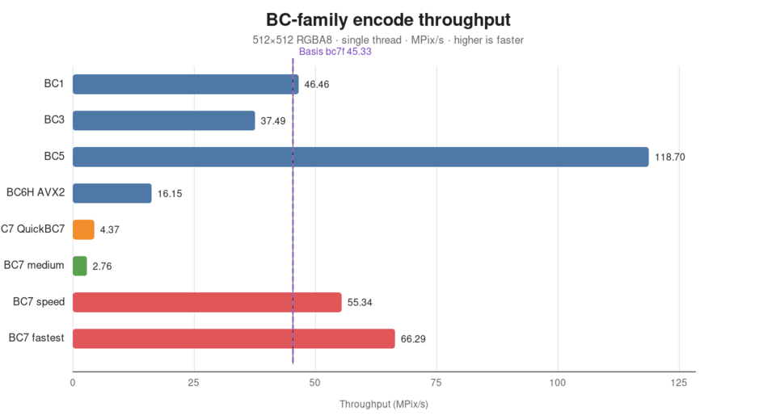

# Tiny EXR image library.

[](https://github.com/sponsors/syoyo)

**Pull request policy:** Only those who have made a one-time sponsorship
contribution of US$5,000 or more are eligible to submit pull requests.


### 🚀 Live demos — all run entirely in your browser

| 🌐 [**EXR viewer (v3)**](https://syoyo.github.io/tinyexr/) | 🎨 [**tocio — OCIO + ACES 2.0**](https://syoyo.github.io/tinyexr/tocio/) | 🧊 [**texcomp — GPU texture compression**](https://syoyo.github.io/tinyexr/texcomp/) |
|---|---|---|
| Decode and view `.exr` by drag-and-drop — all v3 codecs (ZIP / PIZ / PXR24 / B44 / ZSTD / HTJ2K). Spectral EXRs get a wavelength scrubber with **CIE→sRGB** preview, deep images a 3D point cloud. Mobile/touch-friendly, with a fullscreen mode. | Apply an **OpenColorIO** transform — including the **ACES 2.0** output transforms — on **WebGL2**, from a live, editable OCIO config that **JIT-compiles to a GLSL shader**. [More ↓](#tocio--tiny-pure-c11-opencolorio-engine) | Compress to **BC1/3/5/6H/7, ETC2, EAC, ASTC (LDR + HDR)** and decompress back, beside an amplified error view. HDR vs 8-bit under exposure, normal maps ranked by **angular error** (BC5 beats BC7), cubemap/octahedral, downloadable **KTX2 / DDS**. [More ↓](#texcomp--gpu-texture-compression) |

[](https://github.com/syoyo/tinyexr/actions/workflows/ci.yml)

`tinyexr` is a small, pure-C11 library to load and save OpenEXR (.exr)
images, designed to embed into your application. See the
[v3 library overview](#v3--pure-c11-rewrite-recommended) for supported features
and integration details.

**Performance (v3) at a glance** — single-thread decode/encode vs the reference
OpenEXR library, with the vendored **libdeflate** backend on/off (and HTJ2K,
which has no deflate path). With the same backend TinyEXR meets or beats OpenEXR
on the deflate family:


On **ARM64 (Apple M1 / NEON)**, single-thread throughput is now on-par with
OpenEXR/OpenJPH for HTJ2K when using the opt-in M1 scheduler tuning:


See [Performance vs OpenEXR](#performance-vs-openexr) below and
[`doc/performance-vs-openexr.md`](doc/performance-vs-openexr.md) for the full
codec-by-codec and multi-threaded numbers.

# v3 — pure-C11 rewrite (recommended)

TinyEXR's main development line is a ground-up rewrite as a **pure-C11** library
(`include/exr.h` + `src/*.c`) — the **v3 C API**. It is the recommended version
going forward and will be the next major release.

Highlights:

| Area | Support |
|---|---|
| **Language** | Pure C11 core (no C++ in the library); the public header is C++-safe |
| **Codecs** (read + write) | NONE · RLE · ZIP · ZIPS · PIZ · PXR24 · B44/B44A · ZSTD · HTJ2K — DWAA/DWAB intentionally unsupported |
| **Image kinds** | Scanline + tiled (ONE_LEVEL / MIPMAP / RIPMAP), multipart, deep |
| **Streaming** | Block-at-a-time I/O for bounded working memory (see below) |
| **Custom attributes** | Read **and** write arbitrary header attributes; round-trip through save |
| **Spectral** (JCGT 2021 / afichet `spectral-exr`) | Emissive / reflective / polarised; wavelength-cube load + save. Viewer: wavelength scrubber, CIE→sRGB color, per-pixel spectrum plot |
| **Portability** | Freestanding-capable core, callback file I/O, Emscripten WASM (powers the [live viewer](https://syoyo.github.io/tinyexr/)) |
| **Extras** | Allocator hook, runtime SIMD dispatch (SSE2/SSE4.1/AVX2/F16C, NEON), fuzzed sanitizer-clean test suite |

Build: `make lib` (`build/libtinyexr3.a`), `make test-c`, `make c11-gate`.
Unit tests live in `test/unit/test_exr_v3.c` (run under ASan/UBSan via `make
test-c`); `make fuzz-corpus` replays the fuzzer corpus.

The zlib backend for ZIP/ZIPS/PXR24 is selected with `DEFLATE=auto|libdeflate|intree`
(default `auto` → vendored **libdeflate**, faster on natural-image data). `intree`
builds the dependency-free pure-C codec only; freestanding and WASM builds always
use it. Both codecs link under `auto`, so you can switch at runtime with
`exr_zlib_set_backend()` (e.g. for testing or to honor a custom allocator).

## Performance vs OpenEXR

Benchmarked against the reference **OpenEXR** library (4.0-dev) on an idle AMD
Ryzen 9 3950X (Zen2), `asakusa.exr` 660×440, fully in-memory, both pinned to the
same thread count. Throughput in megapixels/s. Full writeup + charts:
[`doc/performance-vs-openexr.md`](doc/performance-vs-openexr.md).

- **Single thread, dependency-free decode** (`DEFLATE=intree`): TinyEXR is faster
  on the cheap codecs — **uncompressed ~3.4×** (2699 vs 789) and **RLE ~2.5×**
  (230 vs 93). With the pure-C deflate codec OpenEXR leads the compressed family
  (ZIP ~1.2×, PXR24 ~1.8×, ZIPS ~2.1×, PIZ ~2.7×, HTJ2K ~2.5–3×), thanks to its
  libdeflate / tuned PIZ / OpenJPH backends.
- **Single-thread encode:** ties/wins on RLE/PIZ/B44; OpenEXR is ~1.5× on
  ZIP/ZIPS, ~1.8× on PXR24, ~4× on HTJ2K.
- **Default decode uses libdeflate** (`DEFLATE=auto`): with the same backend
  TinyEXR **matches or beats** OpenEXR on the deflate family — ZIP decode
  **1.37×** (80.8 vs 58.8), sizes byte-identical. On a broad natural-image corpus
  this is a large lift over the in-tree codec (ZIP ~+73%, ZIPS ~+63%, PXR24 ~+55%).
  The in-tree inflate is *faster* than libdeflate on smooth, highly-compressible
  data (~+8% on 4K texture packs) but slower on high-entropy natural images, so
  libdeflate is the safer hosted default; both link and switch at runtime via
  `exr_zlib_set_backend()`.
- **In-tree codec tuning:** PIZ now has an OpenEXR-style two-window Huffman
  reader and is effectively on-par on the Ryzen 9 3950X snapshot (**33.8 vs
  35.6 MP/s** decode). ZSTD (vendored upstream) decodes ~410–420 Mpix/s here,
  ahead of the libdeflate ZIP path.
- **Multi-threaded** (opt-in C11 threads, `make … THREADS=1` +
  `exr_set_num_threads(n)`): per-block parallel encode/decode scales **~5×
  (ZIP) to ~8.8× (ZIPS)** to 16 threads. At 16 threads TinyEXR **out-decodes
  OpenEXR on RLE/ZIP/ZIPS/B44** (in-tree), and leads the whole deflate family
  decisively with libdeflate (ZIP decode 339.6 vs 226.6, ZIPS 358.5 vs 151.1).

Compressed sizes are essentially identical (the formats interoperate). Net:
TinyEXR is the fast, dependency-free choice for read latency and cheap codecs;
enabling libdeflate and/or threads puts it ahead of OpenEXR on the deflate family
too.

## Streaming block I/O (bounded working memory)

The pure-C11 v3 API (`include/exr.h`) can decode and encode an EXR one block at
a time — one scanline block or one tile. File readers and callback sources fetch
only the requested ranges: they retain metadata/offset tables and active chunk
buffers rather than a copy of the whole encoded file. This covers scanline,
tiled (ONE_LEVEL/MIPMAP/RIPMAP), multipart, and deep parts. Memory readers remain
zero-copy.

Callback sources require a known length and random access. Requests are at most
64 KiB; `EXR_WOULD_BLOCK` exposes the pending range for prefix supplies and retry
of the same operation. Header parsing uses a small read-ahead window. Whole-part
reads retain their decoded output; parallel source reads additionally buffer a
batch capped by the worker count (maximum 64 chunks), with callbacks invoked
only on the calling thread. File-source resources close with the reader.

**Decode** — iterate the chunks of a part, decode each into a small caller
buffer, and unpack the channels you need:

```c
exr_reader *r;
exr_reader_open_memory(data, size, NULL, &r);     /* or _open_source for I/O */
uint32_t n;
exr_reader_num_blocks(r, /*part*/0, &n);
for (uint32_t i = 0; i < n; ++i) {
    exr_block_info bi;
    exr_reader_block_info(r, 0, i, &bi);          /* geometry, no pixel I/O */
    void *blk = malloc(bi.uncompressed_size);
    exr_reader_decode_block(r, 0, i, blk, bi.uncompressed_size);
    for (int c = 0; c < header->num_channels; ++c) {
        /* per-channel planar samples for this block */
        exr_block_extract_channel(header, &bi, blk, bi.uncompressed_size,
                                  c, dst[c].data, dst[c].size);
    }
    free(blk);
}
exr_reader_close(r);
```

Deep parts use the two-step `exr_reader_decode_deep_counts` (which validates the
count capacity and returns the total sample count) followed by
`exr_reader_decode_deep_samples` with an `exr_buffer` per channel.

**Encode** — describe parts with `exr_writer_add_part`, then stream blocks to a
file (or a custom seekable `exr_data_sink`); the offset table is backpatched at
`end_stream`:

```c
exr_writer *w;
exr_writer_create(NULL, &w);
exr_writer_add_part(w, &header, NULL);            /* geometry/channels/tiling */
exr_writer_begin_stream_file(w, "out.exr", EXR_COMPRESSION_ZIP);
for (int y = ymin; y <= ymax; y += lines_per_block)
    exr_writer_write_scanline_block(w, 0, y, channel_rows,
                                    header.num_channels); /* sized buffers */
exr_writer_end_stream(w);                          /* backpatch + close */
exr_writer_destroy(w);
```

Tiles use `exr_writer_write_tile` (the caller supplies each level's tiles for
mipmap/ripmap); deep parts use `exr_writer_write_deep_scanline_block` /
`exr_writer_write_deep_tile`.

## Spectral images (v3)

The v3 API reads and writes spectral EXRs in the JCGT 2021 layout
(afichet/[spectral-exr](https://github.com/afichet/spectral-exr)) — emissive
(`S{n}.{wavelength}nm`), reflective (`T.{wavelength}nm`), and polarised
(Stokes S0–S3) spectra, with the comma decimal convention. Helpers
(`exr_is_spectral`, `exr_spectrum_type_of`, `exr_spectral_channel_wavelength`,
`exr_spectral_wavelengths`, …) plus a high-level wavelength-cube
(`exr_spectral_load_from_file/memory`, `exr_spectral_setup_emissive/reflective`)
live in `include/exr.h`. The [browser viewer](#freestanding--embedded--wasm)
opens a spectral EXR as a wavelength scrubber with a per-pixel spectrum plot and
a CIE→sRGB color composite. Multipart input is supported: the convenience
loaders discover the first flat spectral part, while
`exr_spectral_load_part_from_file/memory` select an explicit part index. Only the
selected part's pixels are decoded; deep spectral parts remain unsupported.

## Freestanding / embedded / WASM

The v3 core (`src/*.c` except `src/exr_stdio.c`) is freestanding: it depends only
on `<stdint.h>`, `<stddef.h>`, and `<limits.h>` — no `<stdio.h>`, `<stdlib.h>`,
`<string.h>`, or `<math.h>`.

- **No stdio in the core.** All file I/O lives in the optional `src/exr_stdio.c`
  (`exr_load_from_file`, `exr_save_to_file`, `exr_writer_finalize_to_file`,
  `exr_writer_begin_stream_file`, `exr_reader_open_file`). Link it for the
  convenient path-based helpers; omit it for embedded/WASM. Everything else does
  I/O through caller callbacks: `exr_data_source` (read) for the reader and
  `exr_data_sink` (write/seek/close) for the streaming writer.
- **`-DEXR_FREESTANDING`** drops the default malloc/free allocator (the caller
  must pass an `exr_allocator`; `exr_default_allocator()` returns NULL) and uses
  the internal mem/str implementations in `src/exr_freestanding.c` instead of
  `<string.h>`. `-DEXR_NO_ZSTD` drops the vendored zstd codec (and its
  allocator); `-DEXR_NO_B44` drops the B44 codec. The B44 perceptual tables are
  computed once at runtime (into `.bss`) using a small in-tree `exp`/`log`
  (`src/exr_b44.c`), so the core needs no `<math.h>` and bakes no large table
  into the object; the table test verifies they match a libm reference
  bit-for-bit (`tools/gen_b44_tables.c` regenerates a precomputed variant if one
  is ever wanted).
- `make freestanding-gate` proves the core builds with no libc (scans every
  object with `nm` for forbidden symbols) and runs a memory round-trip.

**WASM** (`make wasm`, needs `emcc`): builds `build/exr_v3.mjs` + `.wasm` from
the core plus the pure-C binding `examples/wasm/exr_wasm.c`
(`exrw_decode_rgba` / `exrw_encode_rgba` / `exrw_free`), with `FILESYSTEM=0`.
See `examples/wasm/README.md` and the `node examples/wasm/test.mjs` smoke test.

**Browser viewer** (`web/viewer/`, needs `emcc` + CMake): a self-contained
WebGL2 EXR viewer built on the v3 streaming block API — drag-and-drop / upload,
load progress, exposure / gamma / channel controls, zoom / pan, data/display
window + region overlays, a pixel picker, a deep-image 3D point cloud, a
spectral wavelength scrubber + CIE→sRGB color + per-pixel spectrum plot, and a
mobile/touch-friendly UI with fullscreen. Build it with the Emscripten CMake
toolchain (MinSizeRel + `-Oz`):

```sh
cd web/viewer
./build.sh          # emcmake cmake -S . -B build -DCMAKE_BUILD_TYPE=MinSizeRel && cmake --build build
python3 -m http.server   # then open http://localhost:8000/
```

See `web/viewer/README.md` for details.

## Input validation and profiling (v3)

Tiled channels require unit x/y sampling. Unsupported subsampling is rejected
before mipmap/ripmap generation; scanline subsampling remains supported. The
viewer reconstructs Y/RY/BY at every mipmap/ripmap level, including edge tiles.

`make wasm-source-test` runs the source, ownership, spectral, and viewer tests
on WASM32 with checked memory accesses and UBSan. It verifies 32-bit pointers
and exercises sparse files above 5 GiB without allocating the holes. Set
`EMCC` and `NODE` for the local Emscripten SDK. Temporary EXRs stay inside the
module's in-memory filesystem. Native `make test-c THREADS=1` also verifies
caller-thread callbacks and low CPU use while the input source is delayed.

`make bench-source THREADS=1` compares memory, bounded file, and block reads;
`make bench-source-large THREADS=1` adds 2048×2048 and 32-channel sweeps.
See [the benchmark notes](benchmark/README-source.md) for methodology and results.
When changing release-library thread flags, rebuild with `make -B lib THREADS=1`
first (release object flags are not tracked).

## Lean formalization and verification

The [Lean formalization and verification summary](lean/VERIFICATION.md)
describes the machine-checked OpenEXR container and codec models, including
the complete successful PIZ block encoder/decoder round trip, proof
preconditions, validation results and remaining boundaries. The C implementation
is checked against these models through structural and codec differential tests;
the Lean proofs establish properties of the models rather than the C code.

See the [Lean package documentation](lean/README.md) for the module inventory
and build commands. DWAA/DWAB remain intentionally unsupported.

## Third-party licenses (v3)

- **Core** — 3-clause BSD, dependency-free. The HTJ2K/JPH and DEFLATE/PIZ/B44
  codec implementations are original in-tree code.
- **zstd** (`deps/zstd/`, optional, on by default) — BSD-3-Clause, Facebook.
- **libdeflate** (vendored ZIP/ZIPS/PXR24 backend, default on hosted builds via
  `DEFLATE=auto`; `DEFLATE=intree` and freestanding/WASM use the pure-C codec) —
  MIT.

---

# tocio — tiny pure-C11 OpenColorIO engine

Alongside the EXR codec, this repo ships **tocio** (`sandbox/tocio/`): a tiny,
self-contained, **pure-C11** [OpenColorIO](https://opencolorio.org) config engine
and code generator. It parses an OCIO config (a YAML subset), resolves a colour
transform into a flat op list, and runs it on the CPU, ahead-of-time as
C / GLSL / Metal source, or through a small JIT — with first-class **ACES 2.0**
support.

> 🎨 **Live demo:** [**tocio OCIO + ACES 2.0 viewer**](https://syoyo.github.io/tinyexr/tocio/)
> — decode an EXR and apply an OCIO transform on **WebGL2**, with a live, editable
> OCIO config that **JIT-compiles to a GLSL shader**.

Highlights:

| Area | Support |
|---|---|
| **Language** | Pure C11, freestanding-capable (no libc/libm beyond `stdint`/`stddef`; all heap via an allocator hook), zero external dependencies |
| **Config** | OCIO YAML-subset parser: colorspaces, roles, displays/views, view transforms, looks, scene↔display reference bridging; Iridas `.cube`, Sony `.spi1d`/`.spi3d`, and ACES **CLF** LUT files |
| **Execution** | CPU interpreter (scalar + **SSE2/AVX2**, **NEON**), AOT **C** source, **GLSL** (WebGL2 / Vulkan) and **Metal** shader generators, and a **JIT** (x86-64 SSE2/AVX + AArch64 NEON machine code; emits GLSL under WASM) |
| **ACES** | **ACES 2.0** output transforms (CAM16 *JMh* tonescale + chroma / gamut compression) — SDR, HDR, and **D60-simulation** variants; ACEScc / ACEScct / ACEScg / ACES2065-1, the 1.3 RGC gamut-compress LMT, ARRI / Sony / RED / Panasonic camera-log inputs, and sRGB / Rec.1886 / PQ / DCDM / Display-P3 display encodings |
| **Ops** | Matrix, range, exponent / MonCurve, log / log-camera, fixed-function, 1D/3D LUT — invertible where the math allows |

**Validated against the real configs.** `make tocio-validate` parses the
AcademySoftwareFoundation ACES OCIO configs and compares every transform tocio
builds against PyOpenColorIO (the C++ reference engine) on fixed samples —
currently **350 / 377 transforms verified, 0 mismatches** on in-range samples.

Build & test:

```sh
make tocio-lib         # build/libtocio.a
make tocio-test        # unit tests
make tocio-fetch-ref   # fetch the ACES OCIO configs (once)
make tocio-validate    # numerical validation vs PyOpenColorIO
make wasm-tocio-demo   # web/tocio/ browser demo (needs Emscripten)
```

See [`sandbox/tocio/`](sandbox/tocio/) for the engine and
[`web/tocio/`](web/tocio/) for the demo.

---

# tir — tiny content-aware image resize

The repo also ships **tir** (`tools/resize/`): a small, fast, **pure-C11**
image resizer that is HDR-, normal-map-, and displacement/height-map-aware.
Standalone (no dependency on the EXR codec — only the CLI and benchmark link
`libtinyexr3.a` for file I/O), one arena allocation per resize, with runtime
SIMD dispatch. Separable two-pass resampling over f32 with precomputed,
edge-folded, zero-padded coefficient tables and a streaming ring buffer
(O(support) memory).

```c
#include "tir.h"
tir_image_view src = {pixels, w, h, 4, TIR_F32, 0};
tir_image_view dst = {out, w/2, h/2, 4, TIR_F32, 0};
tir_options o; tir_options_init(&o);
o.filter_x = o.filter_y = TIR_FILTER_LANCZOS3;
o.antiring  = 1.0f;   /* confine ringing to the local source range */
o.clamp_min = 0.0f;   /* hard guarantee: no negative pixels */
tir_resize(NULL, &src, &dst, &o);
```

Highlights:

| Area | Support |
|---|---|
| **Language** | Pure C11, `-Wall -Wextra -Werror` clean, overflow-checked size arithmetic; own prefix / allocator hook, zero external dependencies |
| **HDR-aware** | Values never clamped by default; negative-lobe ringing confined by `antiring` (blend toward a reduced-footprint min/max, applied **once after both passes**), so `antiring=1` + `clamp_min=0` is a hard no-negative-pixels guarantee; optional OIIO/SPI highlight compression |
| **Content modes** | **Normal maps** (snorm / unorm / NVTT-C127 / 2-channel RG with `z` reconstructed; renormalized once, `|N|` side output for Toksvig); **height/displacement** (mean-preserving area downscale, grid-vertex registration for 2ⁿ+1 terrains); correct **premultiplied-alpha** filtering; NaN/Inf scrub policies (`zero` / 3×3 `repair` / `error`) |
| **Filters / edges** | Box, triangle, B-spline, Gaussian, Mitchell, Catmull-Rom, Lanczos-2/3; clamp / reflect / wrap; f32 / f16 / u8 / u16 pixel I/O |
| **SIMD** | Runtime **SSE2 / SSE4.1 / AVX2 (+FMA, F16C)**, compile-time **NEON**, **SVE 1.0** behind a `HWCAP_SVE` gate; `deterministic=1` pins scalar kernels for bit-identical output across platforms / levels / thread counts |
| **API** | One-shot `tir_resize`, reusable sampler, **streaming** `push_row`/`pull_row` (O(support) memory), and optional C11-threads band parallelism (byte-identical to serial) |

Beats the in-tree `exr_resize_float` by **2–5×** and is competitive with
stb_image_resize2 (wins every 4-channel/HDR case on the Zen2 bench).
Validated against an independent double-precision reference resampler under the
full sanitizer matrix (ASan / UBSan / LeakSanitizer / ThreadSanitizer), an
exhaustive f16↔f32 converter sweep, and a libFuzzer harness.

Build & test:

```sh
make resize-lib          # build/libtir.a
make resize-cli          # build/tir_resize (EXR in/out)
make resize-test         # unit tests (ASan+UBSan) vs a double-precision oracle
make resize-test-tsan    # ThreadSanitizer
make resize-bench        # MP/s vs exr_resize_float (STB=1 adds stb2)
make resize-fuzz-corpus  # deterministic fuzz replay (ASan+UBSan)
```

```sh
./build/tir_resize in.exr -o out.exr --scale 0.5 --filter lanczos3 \
    --antiring 1 --clamp-min 0 --stats
```

See [`tools/resize/`](tools/resize/) for the library and its README.

---

# texcomp — GPU texture compression

The last mile of a VFX/CG asset pipeline is turning scene-linear EXRs into
something a GPU can sample, and that step usually drags in a pile of C++
dependencies. **texcomp** (`tools/texcomp/`) is a **pure-C11** block compressor —
and decompressor — that does it in-tree:

| codec | bpp | for |
|---|---|---|
| BC1 / BC3 / BC7 | 4 / 8 / 8 | desktop colour |
| BC5 | 8 | desktop **normal maps** (UNORM + SNORM) |
| BC6H | 8 | desktop **HDR** / IBL (uf16 + sf16) |
| ETC2 / EAC | 4–8 | mobile |
| ASTC (LDR + HDR) | 0.9–8 | mobile + desktop, variable block |
| `uni` | 8 | UASTC intermediate: encode once, **transcode** per device |

It comes with **tir** (resize, above), **texpipe** (`tools/texpipe/`: mip chains,
alpha coverage, seam-free cube LOD, normal/roughness coherence, **KTX2 + DDS**
read *and* write) and **envmap** (`tools/envmap/`: equirect ⇄ cubemap ⇄
octahedral, SH, spherical gaussians).

### texcomp BC benchmark

On the benchmark host, texcomp's real-time BC7 mode-6 profiles reach **55.34
MPix/s (`speed`)** and **66.29 MPix/s (`fastest`)**, versus **45.33 MPix/s** for
Basis Universal's analytical `bc7f` reference. The broader BC-family snapshot
is **BC1 46.46**, **BC3 37.49**, **BC5 118.70**, and **BC6H AVX2 16.15 MPix/s**.
The QuickBC7-derived texcomp profile measures **4.37 MPix/s at 53.62 dB**;
`speed` measures **51.43 dB** and `fastest` **48.94 dB** on the benchmark's
gradient quality check.

[](doc/texcomp-bench.md)

See the [full texcomp benchmark notes](doc/texcomp-bench.md) for methodology,
quality caveats, and the exact command to reproduce the snapshot.

```c
#include "texpipe.h"          /* resize -> mips -> compress -> container */
tp_options opt;
tp_options_init(&opt, TP_CONTENT_COLOR, TP_CODEC_BC7);
opt.container  = TP_CONTAINER_KTX2;
opt.srgb_aware = 1;           /* filter in linear light, not in sRGB */

uint8_t *ktx2; size_t n;
tp_process(NULL, &view, 1, &opt, &ktx2, &n);
```

```sh
make texcomp && build/texcomp/texcomp --help
make tools-test        # pure-C gates
make tools-test-all    # + astcenc C++ conformance cross-checks
```

**Every decoder is cross-checked against an independent implementation** — BC7
against [bcdec](https://github.com/iOrange/bcdec), ETC2/EAC against
[Mesa](https://gitlab.freedesktop.org/mesa/mesa), ASTC (LDR and HDR) against
[astcenc](https://github.com/ARM-software/astc-encoder), bit-exact on tens of
thousands of foreign blocks. A round-trip test cannot catch a codec whose encoder
and decoder share the same wrong assumption; doing this found six real bugs that
every round-trip test had passed.

See [`doc/texcomp.md`](doc/texcomp.md) for the full documentation — codecs,
containers, the HDR / normal-map / cubemap / alpha-coverage cases, and the
validation story.

---

# License

3-clause BSD. See [Third-party licenses (v3)](#third-party-licenses-v3) and
[NOTICE](NOTICE) for third-party notices.

# Similar or related projects

* miniexr: https://github.com/aras-p/miniexr (Write OpenEXR)
* stb_image_resize.h: https://github.com/nothings/stb (Good for HDR image resizing)

# Author(s)

Syoyo Fujita (syoyo@lighttransport.com)

# Contributor(s)

* Matt Ebb (http://mattebb.com): deep image example. Thanks!
* Matt Pharr (http://pharr.org/matt/): Testing tinyexr with OpenEXR(IlmImf). Thanks!
* Andrew Bell (https://github.com/andrewfb) & Richard Eakin (https://github.com/richardeakin): Improving TinyEXR API. Thanks!
* Mike Wong (https://github.com/mwkm): ZIPS compression support in loading. Thanks!
